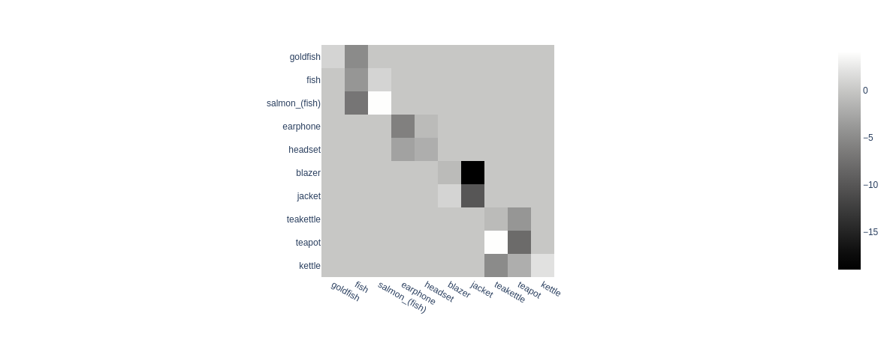

# Why Open-Vocabulary 3D Recognition Gets Confused

**M.S. thesis research, Boston University (Nov 2023 – Apr 2024).** A failure analysis of [OpenShape](https://colin97.github.io/OpenShape/) (NeurIPS 2023), the state-of-the-art model for zero-shot 3D shape recognition, plus two attempts to fix the errors it makes.

> This repository is a fork of the [official OpenShape code](https://github.com/Colin97/OpenShape_code). The OpenShape model, training pipeline and datasets belong to the original authors. **Everything described below is my own work** and is listed under [What I built](#what-i-built).

## TL;DR

- OpenShape reaches ~85% zero-shot accuracy on ModelNet40 (40 classes) but only ~44% on Objaverse-LVIS (1,156 classes). I set out to find out why.
- I clustered the 1,156 categories in CLIP text space and split the errors by type: **25%** of test samples are confused with a *semantically similar* category (vodka bottle → wine bottle, sherbet → ice cream). **28%** are confused with an *unrelated* one (desk → monitor, armor → helmet).
- **Coarse-to-fine fine-tuning** on clusters of confusable categories mostly *shifted* accuracy from some categories to others instead of raising it overall. A weighted ensemble of the base and fine-tuned heads did better than either alone.
- **The point-cloud encoder is not the bottleneck.** Linear probes on the frozen encoder separate 193 of the most-confused category pairs far better than zero-shot (e.g. sherbet vs. ice cream: 19% → 86%). So the errors come from how point clouds are aligned with text and images.
- **Offline hard-negative mining with a triplet loss** gave a small gain in per-class accuracy and no gain in overall accuracy.
- **The main finding is about the data:** captions are noisy (most vodka-bottle captions never mention vodka), and many LVIS categories are not geometrically distinguishable (bag / shoulder bag). Without cleaner labels, model changes have limited headroom.

## Approach and results

### 1. Error analysis
- I built confusion matrices over all 1,156 LVIS categories and ranked the most-confused pairs ([`confusion.py`](src/confusion.py), [`analyse_confusion.py`](src/analyse_confusion.py), [`sort_confusion_matrix.ipynb`](notebooks/sort_confusion_matrix.ipynb)).
- I clustered the CLIP embeddings of the category names with DBSCAN ([`lang_embeds.py`](src/lang_embeds.py), [`dbscan_clustering.ipynb`](notebooks/dbscan_clustering.ipynb)). Each error was then tagged as **in-cluster** (semantically close) or **out-of-cluster** ([`cluster_vs_non_cluster_analysis.ipynb`](notebooks/cluster_vs_non_cluster_analysis.ipynb)).

| Error type (share of LVIS test set) | Example | Share |
|---|---|---|
| In-cluster confusion | vodka bottle → wine bottle | 24.95% |
| Out-of-cluster confusion | desk → monitor | 28.40% |

### 2. Coarse-to-fine fine-tuning
- I picked 10 confusable categories from 4 clusters: goldfish / fish / salmon, earphone / headset, blazer / jacket, teakettle / teapot / kettle.
- I fine-tuned only OpenShape's projection head on them, using a seeded 80/20 split ([`finetune_loader.py`](src/finetune_loader.py), [`main.py`](src/main.py) with `training.freeze_layers`).
- I blended the base and fine-tuned heads into a weighted ensemble ([`finetune_ensemble.py`](src/finetune_ensemble.py)).
- Result: fine-tuning reduced confusion *between* categories in a cluster, but it also lost true positives. In effect, accuracy moved from one set of categories to another. The ensemble beat both models, which is consistent with that reading.

<p align="center"></p>

<!-- TODO(Harsh): add the baseline / fine-tuned / ensemble overall and class accuracy from the thesis slides. -->

### 3. Is the encoder the bottleneck? Pairwise linear probes
- For 193 of the most-confused category pairs, I froze OpenShape's point-cloud encoder and trained a binary linear classifier on top ([`binary_classifier.py`](src/binary_classifier.py), [`main_multi_classifier.py`](src/main_multi_classifier.py), [`analyze_multi_binary.ipynb`](notebooks/analyze_multi_binary.ipynb)).
- The probes separated most pairs far better than zero-shot classification did:
  - sherbet / ice cream: 19% → 86%
  - antenna / windmill: 23% → 96%
  - drawer / desk: 48% → 100%
- So the geometric features are already good enough to tell these categories apart. **The errors come from the alignment with text and images.**

### 4. Offline hard-negative mining with a triplet loss
- I precomputed CLIP text embeddings for every category name, and image embeddings ([`create_img_feat.py`](src/create_img_feat.py)).
- During training, the nearest neighbour of each sample's text or image embedding becomes its hard negative.
- A margin triplet loss is added to OpenShape's contrastive loss ([`train_triplet_loss.py`](src/train_triplet_loss.py), [`configs/train_triplet.yaml`](src/configs/train_triplet.yaml)).
- Result: overall accuracy did not change and per-class accuracy improved slightly, which suggests the loss helps rare categories. The fixed bank of one embedding per category gives far less signal than the 875K training samples.

<!-- TODO(Harsh): add the triplet vs. baseline overall / class accuracy numbers. -->

### 5. The data is the problem
- Captions are often uninformative. Of the captions for objects labelled *vodka*, only two mention vodka ([`results/vodka_text.txt`](results/vodka_text.txt); [`results/control_text.txt`](results/control_text.txt) is a control category).
- Some LVIS categories (bag / shoulder bag / handbag) can't be told apart from geometry alone and arguably should be merged for point-cloud recognition.
- **Future directions:** learning with noisy labels, caption and image augmentation, and mixture-of-experts ensembles.

## What I built

These are all changes on top of upstream commit [`d0a8637`](https://github.com/Colin97/OpenShape_code/commit/d0a8637):

| Area | Files |
|---|---|
| Error analysis and confusion matrices | `src/confusion.py`, `src/analyse_confusion.py`, `src/lang_embeds.py`, `notebooks/*` |
| Standalone ModelNet40 / Objaverse-LVIS / OmniObject3D evaluation | `src/eval.py`, `src/modelnet.py`, `src/objaverse_lvis.py`, `src/omni.py` |
| Category-subset fine-tuning and ensembling | `src/finetune_loader.py`, `src/finetune_ensemble.py`, `src/models/ppat.py` (`ProjectedNoClassification`) |
| Frozen-encoder binary classifiers (single pair and 193-pair sweep) | `src/binary_classifier.py`, `src/train_binary.py`, `src/main_multi_classifier.py` |
| Hard-negative triplet loss | `src/train_triplet_loss.py`, `src/create_img_feat.py`, `src/configs/train_triplet.yaml` |
| Infrastructure | MinkowskiEngine-free PointBERT path, loading checkpoints from Hugging Face, optional wandb, seeding, configurable DDP port (`src/main.py`, `src/data.py`, `src/train.py`, `src/param.py`, `src/utils_func.py`, `src/utils/distributed.py`) |
| Exploratory, not used in the results | LoRA fine-tuning (`src/main_lora.py`, `src/train_lora.py`), alternative contrastive loss (`src/train_new_loss.py`) |

## Running

Environment setup and the training-data download are the same as upstream; see the [OpenShape README](https://github.com/Colin97/OpenShape_code#installation) and [`openshape_env.sh`](openshape_env.sh). Every experiment starts from the public `OpenShape/openshape-pointbert-vitg14-rgb` checkpoint.

```bash
# Zero-shot evaluation on Objaverse-LVIS (exports logits for the analysis notebooks)
python src/eval.py --config src/configs/test.yaml --export_result_dir results/eval

# Fine-tune the projection head on a category subset
python src/main.py --config src/configs/finetune.yaml --train

# Binary linear probe on a frozen encoder
python src/binary_classifier.py --config src/configs/train_binary.yaml

# Contrastive + hard-negative triplet training
python src/main.py --config src/configs/train_triplet.yaml --train
```

Set `WANDB_API_KEY` to log runs to Weights & Biases.

## Limitations

- **The nearest neighbour can be a near-duplicate class.** The closest category can be a near-synonym of the true one (wine bottle for vodka bottle), which makes it a noisy negative.
- **Single seed.** Fine-tuning results come from one run.

## Acknowledgements

Thanks to my thesis advisor and committee at Boston University. This work builds directly on OpenShape:

```bibtex
@misc{liu2023openshape,
  title={OpenShape: Scaling Up 3D Shape Representation Towards Open-World Understanding},
  author={Minghua Liu and Ruoxi Shi and Kaiming Kuang and Yinhao Zhu and Xuanlin Li and Shizhong Han and Hong Cai and Fatih Porikli and Hao Su},
  year={2023},
  eprint={2305.10764},
  archivePrefix={arXiv},
  primaryClass={cs.CV}
}
```

Licensed under Apache 2.0, the same as upstream.
